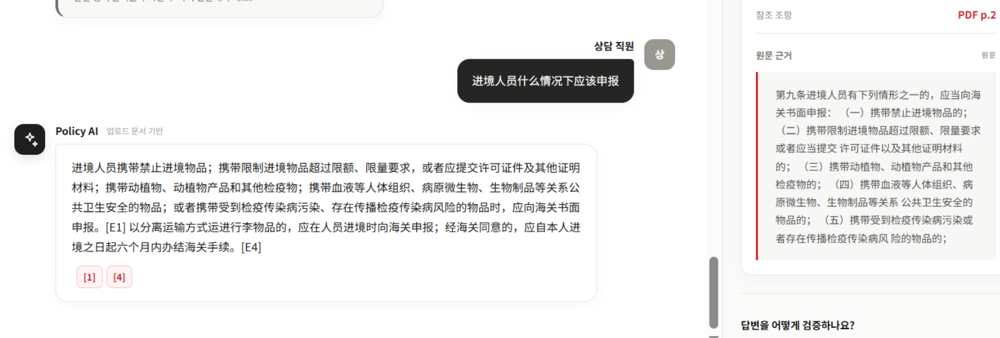
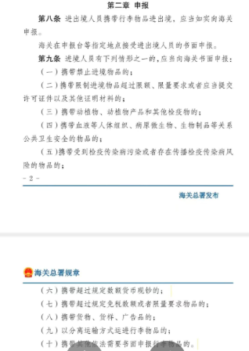

# 验收问题记录：跨页政策条款回答不完整

Refs #39；与 #13 的召回和回答质量跟进相关。本记录不是修复完成说明，不关闭任何 Issue。

记录日期：2026-10-30（韩国时间）。负责人：@sun-cs（孙忠其）。
记录分支基于 main `36848bb6dab81e781fa426b21bc344fb9ea621cc`。
用户截图未附带本次请求日志或提交哈希，因此不把分支基线写成截图已验证的运行版本。

## 1. 按 #39 模板汇总

**模块**：检索与生成；具体故障阶段待确认。

**在哪一步**：在网页 Chat 中询问“进境人员什么情况下应该申报”。

**看到什么**：回答列举第九条前五项申报情形，但没有覆盖下一物理页续列的第六至第十项；同时加入“分离运输行李”相关规定。回答有 [E1]、[E4] 引用，所示 [E1] 卡片为 PDF 物理第2页。

**期望什么**：对该问题，能够综合该条跨物理第2、3页的相关申报情形，保留适用条件，并分别引用真实来源页。若证据不完整，应说明仅覆盖部分情形，不能让用户误以为已给出完整清单。其他条款如作为补充，应与主要清单区分。

**截图**：见下方两张图，不包含 API Key、数据库密码或私有配置。

**能否重复出现**：已提供一次截图记录，本次尚未重复执行请求；不能认定每次出现。

## 2. 已观察到的证据

来源文件：《中华人民共和国海关进出境行李物品监管办法》。
截图显示第九条前五项位于 PDF 物理第2页，第六至第十项续列于物理第3页。
本次条款内容核对依据用户提供的PDF截图，未重新提取整份PDF或生成向量。

### 实际回答与证据卡片

### 原PDF跨页续文

## 3. 初步分析，不作为已确认根因

1. 当前 Chunk 不跨物理页，跨页条款会分成不同片段。这是既定硬约束，不是本身已确认的实现错误。
2. 检索可能命中含“第九条”和前五项的片段，却遗漏缺少重复标题的下一页续文。
3. 另一种可能是续文已经进入模型输入，但生成阶段遗漏，或其他相关证据干扰了回答重点。
4. 截图中的 [E1]、[E4] 是最终使用的引用，不是完整 Top-5，不能据此断言其余证据未被召回。
5. 有效引用只能检查出处映射及部分格式，不证明回答已覆盖条款所有相关款项。现有数字防护也不能检出全部清单遗漏。

Q008 也有跨页申报证据缺口，本问题是新的提问场景，可能存在共同根因；应关联检查，不先认定两个问题完全相同，也不重复建立“已确认检索Bug”的结论。

## 4. 下一步只读诊断

- 优先寻找原请求的完整 Top-5、chunk_id、document_id、物理页码、正文及分数。
- 核对送入模型的完整证据、原始生成和最终 C5，判断遗漏发生在召回、证据整理还是生成阶段。
- 确认原截图对应的代码、模型、Top-k和入库批次。没有原始日志时明确记录“无法回溯原请求”。
- 如需重跑，使用固定基线和同一份资料，另存新运行记录；新一轮检索不能拼到旧回答里冒充原证据。
- 检查数据库中的页码及向量是否与同一版 Chunk 对应，不直接复用旧版向量。

## 5. 后续修复边界与验证目标

尚未选择或实现修复方案。先根据诊断判断是否需要有限的同文档续文补充、证据整理或 Prompt 调整。

硬约束：
- 单个 Chunk 不跨物理页，正文仍不超过500 tokens，不产生空块。
- 每个引用保留真实 document_id、filename、物理页码和原文。
- 不人为塞入 gold 证据，不为单题隐式调大 Top-k，不新增 Hybrid Search、Reranking 或 Agent。
- 若补充相邻页证据，必须限定相关条款及补充范围，并明确区分原始 Top-5 与扩展证据，不能无条件加入整页。

修复后应验证：
- 本问题覆盖第九条十项相关情形，正确引用物理第2、3页，不混入无关结论。
- 增加中韩跨页续文、相邻页新条款、证据不完整和无关页的回归测试。
- 同一轮复测原10道冒烟题，特别核对 Q003/Q008，不只挑选成功输出。
- 分开报告代码实现、Mock 测试、真实检索/生成及人工核对结果。

## 6. 本次提交范围

仅提交本问题说明及两张用户提供的截图。未修改公共契约、切分、检索、生成、数据库或前端业务代码；未重跑模型、未更新向量、未执行数据删除。

AI使用记录：AI辅助整理用户截图、区分观察事实与待验证假设、形成诊断和验收清单；最终根因及修复结果需实际日志、测试和负责人审核确认。
